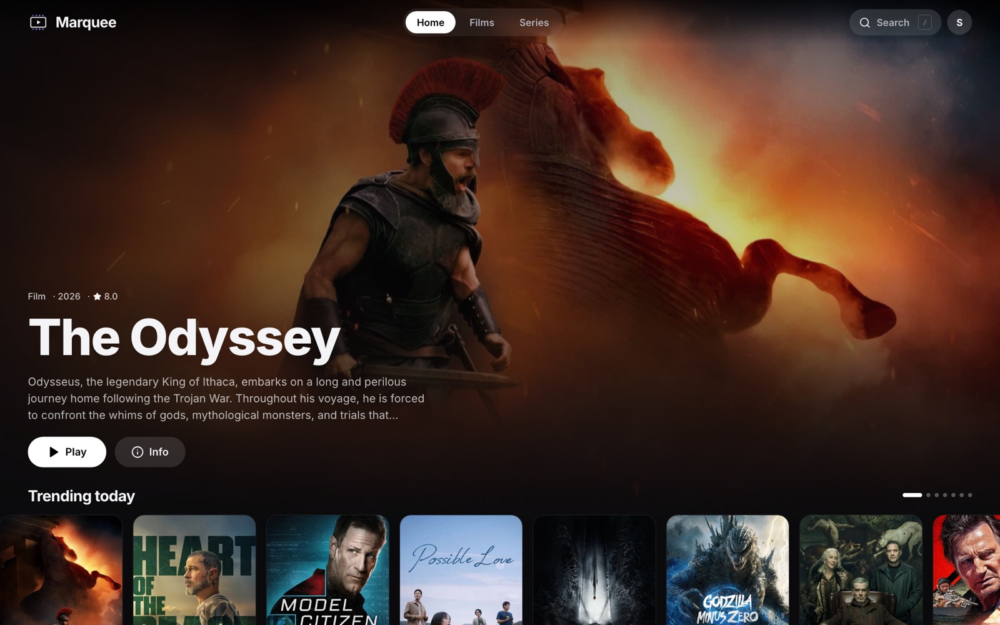
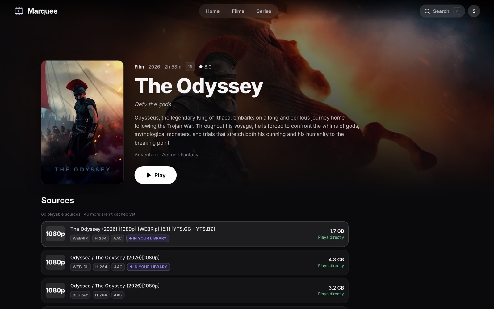
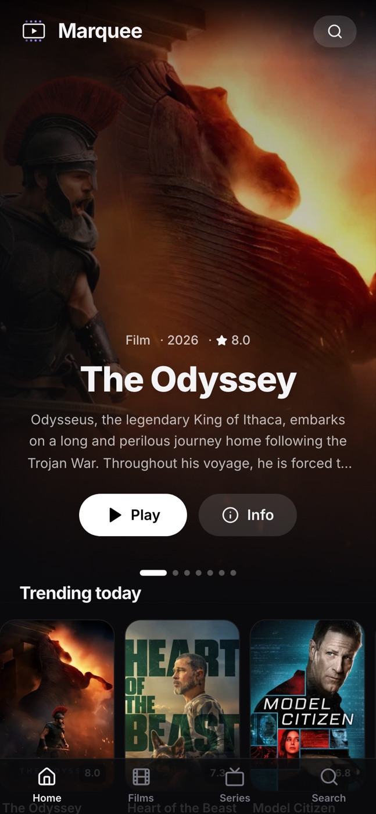

# Marquee

A private, invite-only streaming site for your [TorBox](https://torbox.app) account. Friends get a personal link
instead of an account. They browse a Netflix-style catalogue (from TMDB), press play, and Marquee finds a cached
release, plays it in the browser and remembers where they got to. Your TorBox key stays on your server.



<table>
  <tr>
    <td width="66%"></td>
    <td></td>
  </tr>
</table>

**New here?** Follow the step-by-step guide: **[docs/SETUP.md](docs/SETUP.md)**. It covers installing, the admin
panel, inviting friends and putting it online with a Cloudflare Tunnel.

- **Invite links, no accounts.** One link per person, up to 5 devices each, so it can't be passed around. You can
  see each person's devices in admin and revoke links or devices at any time.
- **Plays almost anything in the browser.** It uses direct play where it can, otherwise it converts the file in the
  browser (MKV, AC-3/E-AC-3 audio, any audio language) and falls back to TorBox's transcoder for the rest. Works on
  iPhone, Android, desktop and TV browsers.
- **Player.** Audio and subtitle switching, speed, double-tap to skip, Chromecast and AirPlay.
- **Sources.** Searches Torrentio, TorrentsDB, Comet and StremThru Torz in parallel, keeps what TorBox already has
  cached and ranks it for the viewer's device. You can add any Stremio-style addon.
- **Continue watching** and **up next** for series, per link.
- **Runs anywhere Docker runs.** A NAS, a mini PC or a VPS. Includes nightly backups and an optional Cloudflare Tunnel.

## What you need

- A machine with **Docker** and the **compose plugin**.
- A **TorBox** account (paid plan) and its API key.
- A free **TMDB** API key: <https://www.themoviedb.org/settings/api>.

## Quick start (one machine)

```bash
git clone https://github.com/ray0189/marquee.git
cd marquee
docker compose up -d --build
```

No configuration is needed to start. Then:

1. Open **http://localhost:8081**. The first visit asks you to choose an admin password.
2. Go to **Keys** and paste your TorBox and TMDB keys. Each one is checked, then stored encrypted.
3. Go to **Invite links** and create one per person. Copy it or show the QR code.
4. Under **Keys → "Address friends use"**, enter the address their devices can reach, e.g.
   `http://192.168.1.50:8080` on your Wi-Fi, or your domain once it's online.

Friends open their link at port **8080**. Admin is only on port **8081**, so keep that port on your own network.

## Deploy to a NAS or server over SSH

From a computer with this folder, deploy to any Linux box running Docker that you can reach by SSH key:

```bash
./deploy.sh 192.168.1.50                 # copy code, build, start (run again to update)
./deploy.sh user@192.168.1.50 --port 9090
./deploy.sh 192.168.1.50 --tunnel        # also run a Cloudflare Tunnel (asks for the token, hidden)
./deploy.sh 192.168.1.50 --migrate       # first time only: move an existing install's data from this machine
```

On the first deploy it writes a `.env` on the server with random internal passwords, and it never overwrites that
file afterwards. Your SSH user must be able to run Docker without sudo
(`sudo usermod -aG docker $USER`, then log in again).

## Put it online (Cloudflare Tunnel)

The short version is below. [docs/SETUP.md](docs/SETUP.md#3-put-it-online-with-a-cloudflare-tunnel) has the full
walkthrough with each Cloudflare screen.

You don't need to open any ports on your router:

1. In the Cloudflare dashboard go to **Zero Trust → Networks → Tunnels** and create a tunnel. Copy its token.
2. Add a public hostname (e.g. `watch.example.com`) with the service set to **`http://web:80`**.
3. Put the token in `.env` (or use `./deploy.sh HOST --tunnel`):
   ```
   CLOUDFLARE_TUNNEL_TOKEN=eyJ...
   COMPOSE_PROFILES=tunnel
   ```
4. Run `docker compose up -d`, then set **Admin → Keys → Address friends use** to `https://watch.example.com`.

The admin panel isn't reachable through the tunnel: `/admin` and `/api/admin` return 404 on the public site.

## Settings

Everything is optional. See [`.env.example`](.env.example) for the full list: ports, the public address,
`MAX_DEVICES`, the backup folder, default sources and Cloudflare Access for the admin host.

## Backups

A `backup` container writes a nightly database dump plus the session secret into `./backups` (or `BACKUP_DIR`)
and keeps 14 days. The session secret encrypts your stored keys and signs every invite link, so keep it with the
dump. Point your own backup tool (Duplicati, restic, …) at that folder.

To restore, start a fresh install, stop it, put `session_secret` into the `appdata` volume, then load the dump
into Postgres:

```bash
gunzip -c marquee-DATE.sql.gz | docker compose exec -T postgres psql -U marquee marquee
```

## Updating

```bash
git pull && docker compose up -d --build      # or: ./deploy.sh HOST
```

The database schema updates itself on start.

## How playback works

1. **Direct play.** The browser plays the file straight from TorBox when the container, video and audio are all
   supported natively.
2. **Browser remux** (`web/src/lib/remux.ts`). The browser reads the file with range requests, copies the video
   untouched into fragmented MP4 and feeds it to the player through Media Source Extensions. Audio is copied, or
   converted locally (AC-3/E-AC-3 to AAC or FLAC). No server CPU is used and any audio track can be picked.
3. **TorBox transcode.** The last resort, for DTS/TrueHD-only files or video the device can't decode.

If a method fails mid-play, the player steps down to the next one at the same position. If TorBox's download link
contains your account key, the file is relayed through your server instead, so the key never reaches a browser.

## Development

```bash
# API tests (Python 3.12). The rate-limiter test uses Redis on localhost:6379 if one is running.
cd api && python -m venv .venv && .venv/bin/pip install -r requirements-dev.txt
.venv/bin/pytest

# Web: run the stack with `docker compose up -d`, then a hot-reloading front end against it
cd web && npm ci && API_URL=http://localhost:8080 npm run dev     # http://localhost:5173
npm run build                                                      # type-check + production build
```

Layout:
- `api/`: FastAPI app and background worker (library sync, search index), tests.
- `web/`: React, Vite, Tailwind and Vidstack.
- `deploy/`: Caddy config and the web image.
- `compose.yaml`: Postgres, Redis, Meilisearch, API, worker, web, backups and the optional tunnel.

## Good to know

- Marquee doesn't host or download anything itself. It searches public Stremio addons and only plays what is
  already in your TorBox cache. You are responsible for what you stream and share. Check TorBox's terms on
  account sharing and keep the circle small.
- Rotate any key or tunnel token that was ever pasted into a chat, an issue or a commit.

## License

[MIT](LICENSE). Use it, change it, share it.
