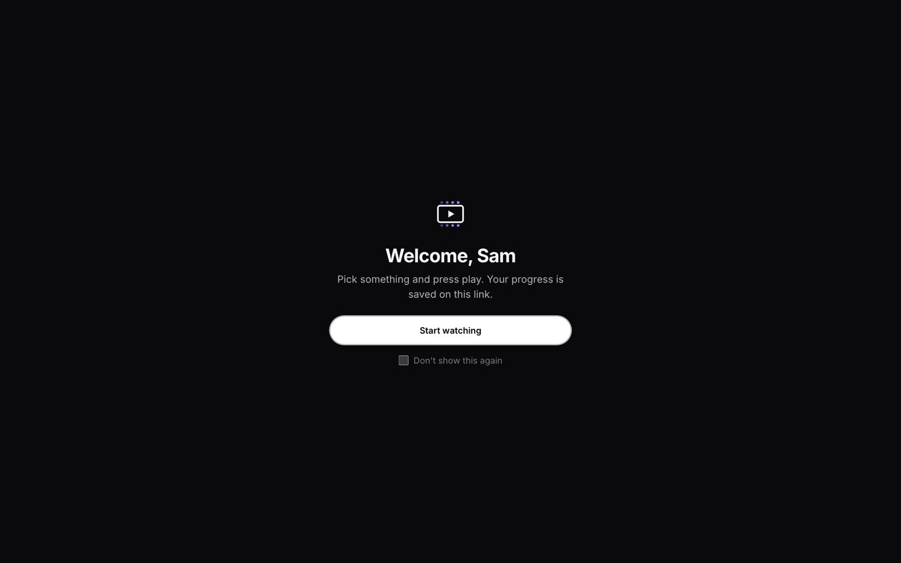

# Setting up Marquee, step by step

This guide goes from nothing to friends watching through their own link. It takes about 15 minutes. There are
three parts; do the first two, and the third only if friends outside your home need access.

1. [Install and first run](#1-install-and-first-run)
2. [Set it up in the admin panel](#2-set-it-up-in-the-admin-panel)
3. [Put it online with a Cloudflare Tunnel](#3-put-it-online-with-a-cloudflare-tunnel)

Plus: [running it on a NAS](#running-it-on-a-nas-or-home-server), [updating](#updating),
[backups](#backups) and [troubleshooting](#troubleshooting).

---

## What you need

| | |
|---|---|
| **A computer that stays on** | A NAS, mini PC, old laptop, Raspberry Pi 4/5 or a cheap VPS. It needs about 2 GB of RAM and 2 GB of disk. Video isn't stored or converted here, so it doesn't need to be powerful. |
| **Docker** | The [Docker Engine](https://docs.docker.com/engine/install/) with the compose plugin on Linux, or [Docker Desktop](https://www.docker.com/products/docker-desktop/) on Mac/Windows. Synology, QNAP, Unraid and TrueNAS have it in their app store. |
| **A TorBox account** | Any paid plan: <https://torbox.app>. Your API key is under **Settings → API**. |
| **A TMDB API key** | Free. Create an account, then go to <https://www.themoviedb.org/settings/api> and request a developer key. Either the "API Key" or the "Read Access Token" works. |

Check Docker works before you start:

```bash
docker compose version
```

---

## 1. Install and first run

Download the code and start it:

```bash
git clone https://github.com/ray0189/marquee.git
cd marquee
docker compose up -d --build
```

The first build takes 3–10 minutes; later starts take seconds. When it's done, `docker compose ps` should show
everything as `running`/`healthy`.

You don't need a config file. Passwords between the containers and the secret that signs invite links are
generated on the first start. To change a setting later, copy `.env.example` to `.env`, edit it, and run
`docker compose up -d` again.

### Change the name (optional)

To call your site something other than "Marquee", put this in `.env` and rebuild:

```bash
echo "APP_NAME=MyFlix" >> .env
docker compose up -d --build
```

---

## 2. Set it up in the admin panel

Open the admin panel **on the machine itself, or another device on the same network**:

- On the same machine: <http://localhost:8081>
- From another device: `http://<the machine's IP>:8081`, e.g. `http://192.168.1.50:8081`


> **The admin panel is local-only.** It runs on its own port (**8081**) and is never served through the public
> site or a Cloudflare Tunnel: `/admin` returns 404 there. Only someone on the same network as the server (in
> practice, the person who set it up) can open it, and they also need the admin password. Friends with invite
> links can watch, but can't see or change keys, links, sources or settings.

Then:

1. **Choose an admin password.** The first visit asks for one.
2. **Keys.** Paste your **TorBox** key and **TMDB** key. Each is checked before it's saved, and both are stored
   encrypted.
3. **Keys → "Address friends use".** This is the start of every invite link, so it must be an address your
   friends' devices can open:
   - At home only: `http://192.168.1.50:8080` (your machine's IP and port **8080**).
   - Online: your tunnel address, e.g. `https://watch.example.com` (see part 3).
4. **Invite links.** Type a name and press **Create link**. Copy the link or show the QR code, then send it to
   that person. Each link:
   - works on up to **5 devices** (change with `MAX_DEVICES` in `.env`),
   - keeps its own watch history and "continue watching",
   - can be revoked at any time, and you can remove single devices under **Devices**.
5. **Sources** (optional). Torrentio, TorrentsDB, Comet and StremThru Torz are on by default. You can add any
   Stremio-style addon base URL (the part before `/stream/...`).
6. **Quality** (optional). Set a minimum resolution, block cams and screeners, and choose whether uncached
   releases may be added to TorBox.

Open your own invite link to test it. You should see "Welcome, <name>" and then the home page.



> **Ports, in short:** friends use **8080**. Admin is **8081** and must stay on your own network. Never forward
> 8081 on your router.

---

## 3. Put it online with a Cloudflare Tunnel

A tunnel lets friends reach the site at `https://watch.your-domain.com` from anywhere. You don't open any router
ports, your home IP stays hidden, and HTTPS is automatic. It's free, but you need a domain on Cloudflare (a cheap
one is fine).

### 3.1 Create the tunnel

1. Sign in at <https://one.dash.cloudflare.com> and open **Networks → Tunnels**.
2. **Create a tunnel** → choose **Cloudflared** → give it a name (e.g. `marquee`) → **Save**.
3. On the "Install connector" screen choose **Docker**. You'll see a command containing
   `--token eyJ...`. **Copy only the token** (the long `eyJ...` string). Don't run the command; Marquee runs the
   connector for you.

### 3.2 Give the token to Marquee

Add two lines to `.env` in the `marquee` folder (create the file if it doesn't exist):

```bash
CLOUDFLARE_TUNNEL_TOKEN=eyJhIjoi...your-whole-token...
COMPOSE_PROFILES=tunnel
```

Then start it:

```bash
docker compose up -d
docker compose logs cloudflared --tail 20     # look for "Registered tunnel connection"
```

If you deploy with the script, `./deploy.sh HOST --tunnel` asks for the token (input is hidden) and does this for you.

> Treat the token like a password. If it was ever pasted into a chat, an issue or a commit, delete the tunnel's
> token in Cloudflare (**Refresh token**) and use the new one.

### 3.3 Point a hostname at Marquee

Back in Cloudflare, in your tunnel, open **Public Hostname → Add a public hostname**:

| Field | Value |
|---|---|
| Subdomain | `watch` (or anything) |
| Domain | your domain |
| Path | *(empty)* |
| Service type | **HTTP** |
| URL | **`web:80`** |

Use `web:80` exactly, **not** your server's IP. The connector runs inside Marquee's Docker network, where the
website is called `web`.

Save, wait a few seconds, then open `https://watch.your-domain.com`. You should see the "invite-only" page.

### 3.4 Use the new address in invite links

In the admin panel set **Keys → Address friends use** to `https://watch.your-domain.com`. Existing links update
straight away; press **Show link** to copy them again.

### Already running another tunnel?

That's fine. Each tunnel has its own token and connector, so Marquee's runs alongside any others (e.g. one for
another app).

### What the internet can and can't reach

- The public site serves the player and the API for invite-link holders only. Without a valid link, everything
  returns "invite-only".
- `/admin` and `/api/admin` return **404** on the public site. Admin is only on port 8081 on your network.
- Visitors' real IPs are used for rate limiting (Cloudflare's `Cf-Connecting-Ip`), and the header can't be faked
  from inside your network.

---

## Running it on a NAS or home server

If you'd rather manage it from your laptop, `deploy.sh` copies the code over SSH, builds and starts it on the
server:

```bash
ssh-copy-id you@192.168.1.50                 # once, so SSH doesn't ask for a password
ssh -t you@192.168.1.50 'sudo usermod -aG docker $USER'   # once, then log out and back in on the server
./deploy.sh you@192.168.1.50
```

- Run it again any time to update. It never overwrites the server's `.env` or backups.
- `--tunnel` sets up the Cloudflare Tunnel token (see above).
- `--port 9090` uses a different port for friends.
- `--migrate` moves an existing install (database, history, links, keys) from the machine you run it on to the
  server. It stops the local copy first so the data is consistent.

On a Synology/QNAP/Unraid box without SSH-friendly Docker, you can instead copy the folder over and run
`docker compose up -d --build` in a terminal there, or import `compose.yaml` as a "project"/"stack" in the NAS's
Docker app.

---

## Updating

```bash
git pull
docker compose up -d --build
```

The database schema updates itself on start, and invite links and history are kept.

---

## Backups

The `backup` container saves a database dump and the session secret every night, keeping 14 days, in:

- `./backups` next to `compose.yaml`, or
- the folder in `BACKUP_DIR` (in `.env`), e.g. `BACKUP_DIR=/mnt/storage/backups/marquee` so your existing backup
  tool (Duplicati, Hyper Backup, restic…) picks it up.

The session secret encrypts your stored keys and signs every invite link. Without it, a restored database can't
use its keys and every link stops working, so always keep it with the dump.

**Restore** on a fresh install:

```bash
docker compose up -d && docker compose stop api worker
docker compose cp backups/session_secret api:/data/session_secret
gunzip -c backups/marquee-YYYY-MM-DD.sql.gz | docker compose exec -T postgres psql -U marquee marquee
docker compose up -d
```

---

## Troubleshooting

| Problem | Fix |
|---|---|
| **Friends see "That link didn't work"** | The link was revoked, or "Address friends use" points somewhere their device can't reach (a `localhost` link only works on the server itself). Check **Keys → Address friends use**. |
| **"This link is already in use on 5 devices"** | Admin → Invite links → click the **Devices** count → remove old devices, or raise `MAX_DEVICES`. |
| **Home page says it needs a TMDB key** | Add it under Admin → Keys. |
| **No sources / "nothing cached"** | Check the TorBox key under Keys and that sources are enabled under Sources. Rare titles may have no cached release; turn on "allow uncached" in Quality to let TorBox download them. |
| **Plays but no sound, or the wrong language** | Use the player's audio button. Every track in the file is listed. |
| **Cloudflare shows error 502/1033** | The connector isn't running or can't see `web`. Check `docker compose logs cloudflared` and that the hostname's service is `http://web:80`. |
| **Admin page won't open from your phone** | Use the server's IP with port **8081**, on the same Wi-Fi. Admin is deliberately not available through the tunnel. |
| **Want to change the admin password** | Admin → **Keys** → **Admin password**. It asks for the current one first. |
| **Forgot the admin password** | `docker compose exec api python -m app.cli reset-admin-password`, then choose a new one on your next visit to admin. |
| **Something else** | `docker compose logs api --tail 100` usually says what's wrong. |
